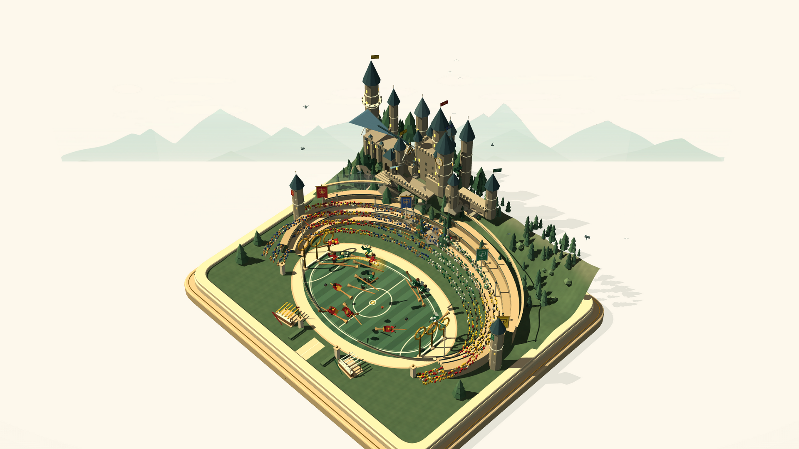

# The Hogwarts Quidditch Pitch — a 3D diorama

A single-file, fully self-contained Three.js diorama of the Hogwarts Quidditch pitch, with a free orbit camera and high-resolution, antialiased rendering.



## Run it

Open **`index.html`** in a modern browser (Chrome, Edge, Firefox or Safari). No server, CDN, network access, external images, fonts or audio are needed — Three.js r128 and all textures/geometry are inlined or generated procedurally.

## Controls

- **Drag** (one finger on touch) to orbit the diorama 360°
- **Scroll** or **pinch** to zoom
- **Double-click** or the **Reset** button to return to the hero view
- **Perspective / Orthographic** switches projection without moving the camera
- **Auto-rotate** slowly turns the diorama while idle; any interaction pauses it, and the setting is honored by `prefers-reduced-motion`

The camera eases with a little inertia after a drag and gently pulls back when the castle swings into the foreground, so nothing is cropped as you rotate.

## What is in the scene

- Hogwarts pitch with mown stripes, boundary markings and three golden hoops at each end
- Wrap-around grandstand with thousands of procedurally placed spectators, four large house banners (Gryffindor, Ravenclaw, Slytherin, Hufflepuff), slate-green railings and two stand towers
- Full Gryffindor and Slytherin teams (7 players each: 3 chasers, 2 beaters, 1 keeper, 1 seeker) on smooth Catmull–Rom flight paths with banking, animated capes and scarves, keeper/beater gear, quaffle passes and bludgers
- Harry (red and gold, extra-long gold scarf) chasing the Golden Snitch, with a gold spark trail and sparks
- Hogwarts castle with the Great Hall, keep, clock tower, astronomy tower, viaduct, curtain walls, lit windows and stone gables, on a forested hill with rocks, mountain silhouettes, mist, birds and long tree shadows
- Warm directional sunlight with soft PCF shadows, a cream display plinth with a brass snitch plaque, and a clean warm-white background
- The distant ridges, haze and mist banks are billboarded onto the orbit's azimuth, so every angle has a complete horizon
- Rendering: full-window canvas at up to 2× device pixel ratio with MSAA, mipmapped/anisotropic textures, a 4096² shadow map, and a subtle CSS vignette

## Working on it

The readable scene source is `src/app.js`; `src/dev.html` loads it with the local Three.js build. To regenerate the single-file deliverable:

```bash
node build.js
```

Three.js r128 is included under the MIT license (see `vendor/three.LICENSE.txt`).
